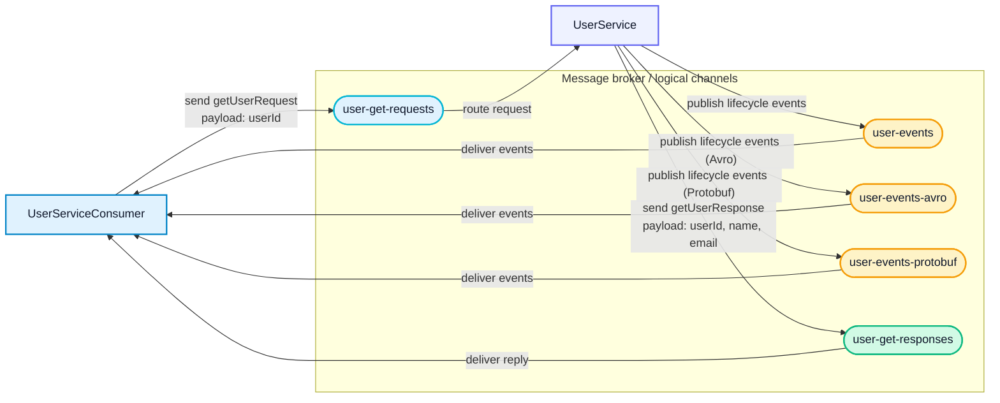

# Example: Bi-Directional Contract Testing with AsyncAPI

## What is this?

This repository demonstrates how to write **Pact consumer tests for a
message-based service** and verify the provider contract using **PactFlow's
AsyncAPI bi-directional contract testing (BDCT)** feature.

The consumer pact and the provider's **AsyncAPI document** are both
published to PactFlow, which compares them server-side.

The provider proves it actually implements its AsyncAPI document using
**[Drift](https://support.smartbear.com/swagger/contract-testing/docs/en/drift/how-to-guides/async-api.html)**.
Drift runs against the real provider over a **Kafka** broker in Docker:
it publishes messages to the provider, collects the replies and side
effects, and checks them against the document. The Drift results are
published to PactFlow with the AsyncAPI document as the provider's
self-verification. This mirrors
[`example-bi-directional-provider-drift`](https://github.com/pactflow/example-bi-directional-provider-drift),
which does the same for HTTP and OpenAPI.

This repo currently holds both the consumer and provider side of the
example in one place. It will eventually be split into standalone
consumer/provider repos.

### Two messaging patterns are demonstrated

| Pattern | AsyncAPI action | Pact interaction type |
|---|---|---|
| **Fire-and-forget** | `receive` | `Asynchronous/Messages` |
| **Request/Reply** | `send` + `reply` | `Synchronous/Messages` |

### Three payload formats are demonstrated

| Format | Consumer contract | Provider contract | Verified by Drift |
|---|---|---|---|
| **JSON** | Pact message with a JSON body | JSON Schema payload | Yes |
| **Avro** | Pact V4 message written by the [Pact Avro plugin](https://github.com/ZirekHQ/pact-avro-plugin) | Avro schema embedded in the payload | Yes (needs a Drift release with the `avro` plugin, newer than 2608.3.0) |
| **Protobuf** | Pact V4 message written by the [Pact Protobuf plugin](https://github.com/pactflow/pact-protobuf-plugin) | `.proto` source embedded in the payload | Yes |

The Avro and Protobuf channels carry the same `userCreated` event as the JSON
one, so the three are easy to compare. See
[Avro and Protobuf payloads](#avro-and-protobuf-payloads) below.

---

## Project layout

```
.
├── src/
│   ├── consumer.ts             # User Service event handlers + Avro/Protobuf decoders (consumer code)
│   ├── consumer.test.ts        # Pact V4 consumer tests (JSON, Avro and Protobuf)
│   ├── schemas/                # The consumer's copy of the Avro and Protobuf schemas
│   └── provider/
│       ├── userService.ts      # User Service business logic (provider code)
│       ├── kafka.ts            # Kafka consumers/producer for the AsyncAPI channels
│       ├── schemas/            # The provider's copy of the Avro and Protobuf schemas
│       └── server.ts           # Entry point + test-support HTTP API
├── provider/
│   └── asyncapi.yaml           # AsyncAPI 3.1.0 document (provider contract)
├── drift/
│   ├── user-service.drift.yaml # Drift test cases
│   ├── user-service.lua        # Lifecycle hooks that seed provider state
│   └── probes/user-state.ts    # Probe that reports the result of an injected event
├── scripts/wait-for-health.ts  # Waits for the provider to be ready
├── compose.yaml                # Local Kafka broker
├── pacts/                      # Generated Pact files (git-ignored)
├── output/                     # Drift results and provider log (git-ignored)
├── Makefile                    # install / plugins / test / verify / publish / can-i-deploy / deploy
├── .github/workflows/          # CI: test → verify → publish → can-i-deploy → deploy
├── package.json
└── vitest.config.ts
```

---

## Quick start

Prerequisites: Node.js 24+, Docker, and a PactFlow workspace with Drift enabled.

```bash
# Install dependencies (includes the Drift CLI, @pactflow/drift)
npm install

# Install the Pact Avro and Protobuf plugins into ~/.pact/plugins
# (make test also does this, and skips plugins that are already installed)
make install_plugins

# Log Drift in to your PactFlow workspace (one-off)
npx drift auth login https://your-instance.pactflow.io

# Consumer — run the Pact tests → generates ./pacts/*.json
make test

# Provider — start Kafka, then verify the provider with Drift
make kafka_up
make test_provider
make kafka_down

# Everything, as CI does it: test, verify, publish both contracts to
# PactFlow, then check can-i-deploy. Credentials come from the environment
# or from a git-ignored .env file (cp .env.example .env)
export PACT_BROKER_BASE_URL=https://your-instance.pactflow.io
export PACT_BROKER_TOKEN=your-token
make fake_ci
```

Individual stages:

```bash
make install_plugins             # install the Pact Avro and Protobuf plugins
make test                        # run consumer tests
make publish_pact                # publish the consumer pact
make kafka_up / make kafka_down  # start / stop the local Kafka broker
make test_provider               # start the provider and run Drift against it
make publish_provider_contract   # publish the AsyncAPI doc + Drift results (needs EXIT_CODE)
make can_i_deploy                # gate a deployment
```

To use a different Drift CLI, such as a local build, set `DRIFT` (and
`DRIFT_HOME_DIR`, if its plugins aren't next to the executable):

```bash
DRIFT_HOME_DIR=~/.drift make test_provider DRIFT=~/.drift/bin/drift
```

To work on the provider interactively, run it yourself and point Drift at it:

```bash
make kafka_up
npm run start:provider                                 # terminal 1
npx drift verify -f drift/user-service.drift.yaml      # terminal 2
```

---

## CI setup

The GitHub Actions workflow (`.github/workflows/build.yml`) needs two
settings configured in this repository (Settings → Secrets and variables →
Actions):

- **Variable** `PACT_BROKER_BASE_URL` — the PactFlow instance URL (e.g.
  `https://your-instance.pactflow.io`)
- **Secret** `PACT_BROKER_TOKEN` — an API token for that instance

Without these, the `test`, `can-i-deploy`, and `deploy` jobs will run
against an empty broker URL and fail. The same credentials log in to Drift
(`npx drift auth login`), so the workspace must have Drift enabled.

The `test` job installs the Pact plugins (cached between runs) and starts
Kafka with Docker Compose on the runner. It uploads
the `output/` directory (Drift results and provider log) as a
build artifact.

---

## How it works

### Consumer side

The consumer tests (`src/consumer.test.ts`) use **Pact V4** (`@pact-foundation/pact`)
to describe the messages the consumer expects.  Each interaction is linked to
the relevant **AsyncAPI operation** via the `.reference()` call:

```ts
pact
  .addAsynchronousInteraction()
  .reference('AsyncAPI', 'operationId', 'receiveUserEvents')
  .expectsToReceive('a user-created event', (builder) => {
    builder.withJSONContent({ userId: string('u-abc-123'), email: string('...') });
  })
  .executeTest(v4SynchronousBodyHandler(handleUserCreated));
```

Running the tests writes a Pact file to `./pacts/` with a `comments.references`
block that PactFlow uses to look up the correct AsyncAPI operation:

```json
{
  "comments": {
    "references": {
      "AsyncAPI": {
        "operationId": "receiveUserEvents",
      }
    }
  }
}
```

### Provider side

The provider (`src/provider/`) is a small Node.js service. It consumes
`user-events` and `user-get-requests` from Kafka and replies on
`user-get-responses`.

#### 1. Verify the provider against its AsyncAPI document with Drift

`make test_provider` starts the provider, waits for its Kafka consumers to
join their groups, and runs `drift verify` with
`drift/user-service.drift.yaml`. Drift chooses how to test each operation
from its AsyncAPI `action`:

| Operation | Drift mode | What Drift does |
|---|---|---|
| `receiveUserEvents` (`receive`) | `async-inject` | Publishes a `userCreated` / `userDeleted` event to `user-events`, then runs `drift/probes/user-state.ts`. The probe asks the provider for the resulting user state and returns it as JSON. Drift compares that JSON with the test's `expected` block. |
| `receiveUserEventsAvro` / `receiveUserEventsProtobuf` (`receive`) | `async-inject` | As for `receiveUserEvents`, but Drift encodes the event with the Avro or Protobuf schema in the AsyncAPI document (the `avro` and `protobuf` Drift plugins) and publishes it to `user-events-avro` or `user-events-protobuf` |
| `getUser` (`send` + `reply`) | `async-request-reply` | Subscribes to `user-get-responses`, publishes a `getUserRequest` with a `correlation-id` header, and captures the reply carrying the same id |

Drift also validates every message it publishes or captures against the
schemas in the AsyncAPI document. The `operation:started` hook in
`drift/user-service.lua` resets the provider before each operation. It also
seeds any users the operation needs, through a test-only HTTP API on port
8081.

Three additions to `provider/asyncapi.yaml` make it runnable by Drift without
changing any message schemas:

- `defaultContentType: application/json`, so Drift knows how to encode the
  payloads it publishes
- a `servers.local` entry for the Kafka broker, which Drift uses as its
  default connection
- a `correlationId` (`$message.header#/correlation-id`) on the request/reply
  messages, which tells Drift how to match a reply to its request

#### 2. Publish the AsyncAPI document and the Drift results

```bash
make publish_provider_contract EXIT_CODE=0
make can_i_deploy
```

This runs, via `@pact-foundation/pact-cli`:

- `pactflow publish-provider-contract provider/asyncapi.yaml --provider
  pactflow-example-bi-directional-provider-asyncapi --verifier drift
  --verification-results output/.../verification.*.result ...`. This
  uploads the spec with Drift's results as the provider's
  self-verification, and lets PactFlow compare it with previously
  published consumer pacts. `make test_and_publish` publishes whether Drift
  passed or failed, and passes Drift's exit code in `EXIT_CODE`.
- `pact-broker can-i-deploy --pacticipant
  pactflow-example-bi-directional-provider-asyncapi ...` — checks whether
  the current provider version is safe to deploy to `production`.

---

## Avro and Protobuf payloads

PactFlow compares Avro and Protobuf message payloads as well as JSON. See the
[AsyncAPI documentation](https://support.smartbear.com/swagger/contract-testing/docs/en/user-guide/contract-testing/bi-directional-contract-testing/supported-contracts/asyncapi.html)
for the full rules.

### Consumer: write the pact with a Pact plugin

Binary interactions must use Pact V4 and be written by the Pact Avro or
Protobuf plugin. The plugin encodes a real message from the consumer's schema,
records matching rules, and embeds the schema in the pact so that PactFlow can
compare it with the provider's schema. Reference the AsyncAPI operation in the
same way as for JSON:

```ts
pact
  .addAsynchronousInteraction()
  .reference('AsyncAPI', 'operationId', 'receiveUserEventsProtobuf')
  .usingPlugin({ plugin: 'protobuf', version: '0.8.1' })
  .expectsToReceive('a user-created event (Protobuf)')
  .withPluginContents(
    JSON.stringify({
      'pact:proto': path.resolve(schemaDir, 'user.proto'),
      'pact:message-type': 'UserCreated',
      'pact:content-type': 'application/protobuf',
      user_id: "notEmpty('u-abc-123')",
      email: "notEmpty('user@example.com')",
    }),
    'application/protobuf',
  )
  .executeTest(async (message) => {
    handleUserCreated(decodeUserCreatedProtobuf(bytesOf(message.contents.content)));
  });
```

The Avro test is the same, with `pact:avro` and `pact:record-name` instead.
The test hands the encoded bytes to the consumer's real decoder
(`src/consumer.ts`, using [`avsc`](https://www.npmjs.com/package/avsc) and
[`protobufjs`](https://www.npmjs.com/package/protobufjs)).

Pact JS passes plugin-generated contents to the test as a base64 string, so
the `bytesOf()` helper in `src/consumer.test.ts` turns them back into a `Buffer`.

### Provider: embed the schema in the AsyncAPI document

Each message declares its format with `schemaFormat` and embeds the schema.
PactFlow doesn't follow external `$ref`s or query schema registries:

```yaml
userCreatedProtobuf:
  contentType: application/protobuf
  payload:
    schemaFormat: application/vnd.google.protobuf;version=3
    x-drift-proto-message: users.UserCreated
    schema: |
      syntax = "proto3";
      package users;
      message UserCreated {
        string user_id = 1;
        string email = 2;
        optional string name = 3;
      }
```

The Avro message uses `schemaFormat: application/vnd.apache.avro;version=1.9.0`
with the record as `schema`. A `.proto` source can define several messages, so
`x-drift-proto-message` names the one to use: the message's key
(`userCreatedProtobuf`) isn't a message in the schema. Drift and PactFlow both
read it.

The consumer (`src/schemas/`) and the provider (`src/provider/schemas/`) each
keep their own copy of the schemas, as they would in separate repositories.
That is what makes the comparison meaningful: PactFlow checks that the
consumer's schema can still read what the provider's schema describes.

### How they're compared

For each binary interaction PactFlow runs three checks:

1. **Format:** the pact's payload and the provider's message must be the same
   format (`message.payload.format.incompatible` otherwise).
2. **Value:** the consumer's example message is decoded and validated against
   the provider's schema, as for JSON.
3. **Structure:** the consumer's embedded schema is compared with the
   provider's, the way the consumer's decoder reads the provider's messages.
   This catches changes that keep the example valid but break decoding.

### Try breaking it

Two changes to `provider/asyncapi.yaml` that the value check alone can't see,
because the example message is still valid:

- Renumber the Protobuf `email` field from `2` to `4`.
- Make the Avro `email` field nullable: `type: ["null", "string"]`.

Publish the AsyncAPI document again, and PactFlow fails both interactions:

```
a user-created event (Protobuf)
  message.payload.incompatible: The consumer reads field email as number 2,
  but the provider's email is number 4 (FIELD_NO_DELETE)

a user-created event (Avro)
  message.payload.incompatible: The provider may write null for email, which
  the consumer reads as string and can't read null (TYPE_MISMATCH)
```

---

## AsyncAPI document overview



The `provider/asyncapi.yaml` defines:

- **`userEvents` channel** (`user-events`) — carries `userCreated` and
  `userDeleted` events consumed by downstream services.
- **`userEventsAvro` channel** (`user-events-avro`) — carries `userCreated`
  encoded with Avro.
- **`userEventsProtobuf` channel** (`user-events-protobuf`) — carries
  `userCreated` encoded with Protobuf.
- **`getUserRequests` / `getUserResponses` channels** — used for synchronous
  user lookup via request/reply (AsyncAPI 3.x `reply` block).

### Operations

```
receiveUserEvents          action: receive   → fire-and-forget events (JSON)
receiveUserEventsAvro      action: receive   → fire-and-forget events (Avro)
receiveUserEventsProtobuf  action: receive   → fire-and-forget events (Protobuf)
getUser                    action: send      → request/reply lookup
```